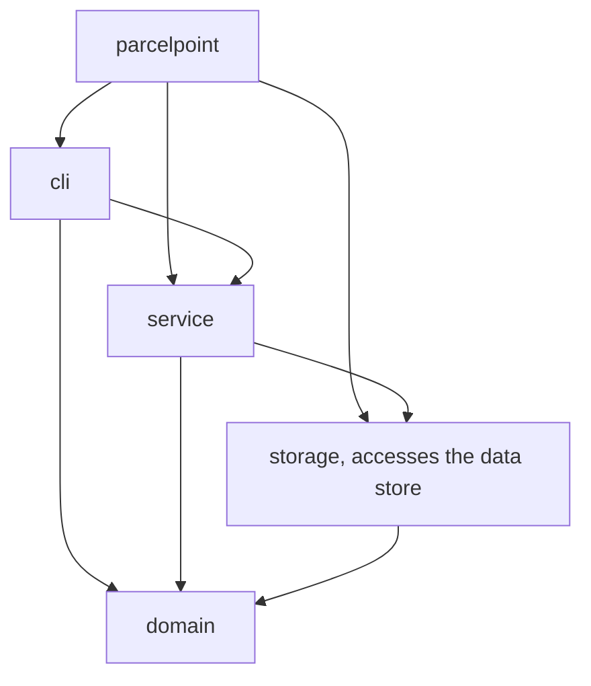
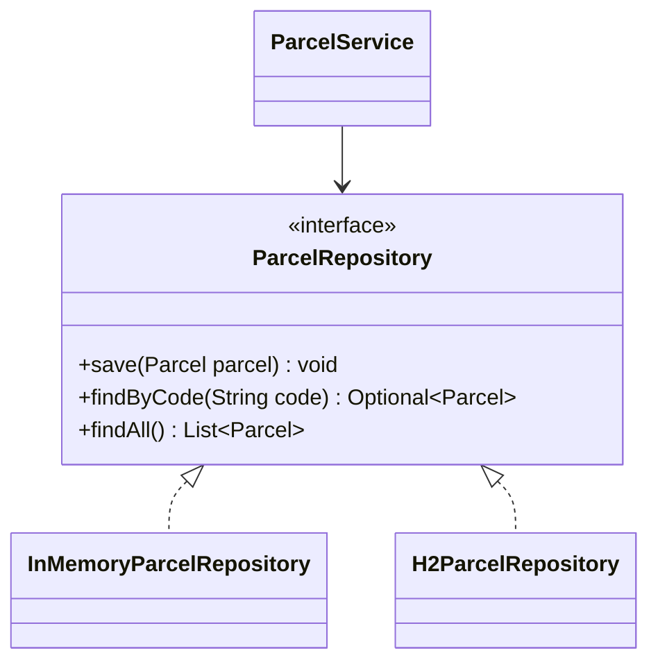
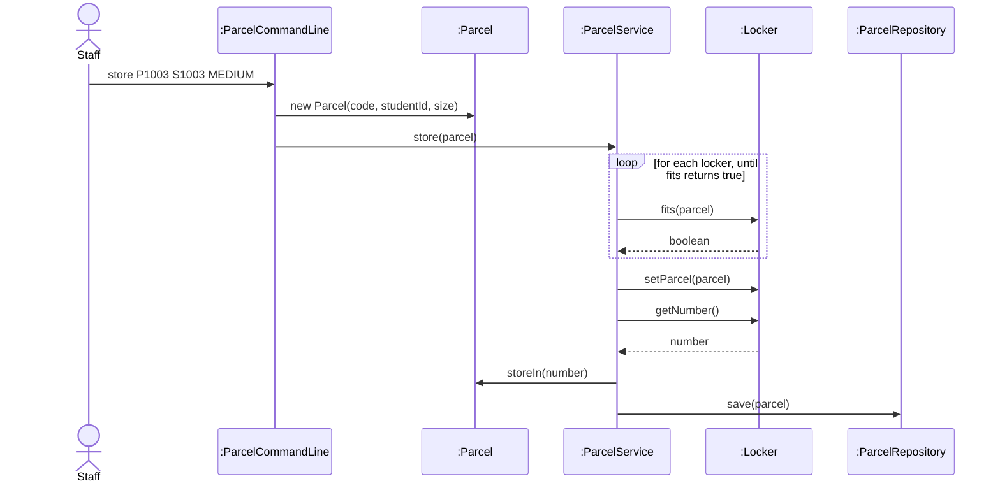

# Lab Report, Designing the Data Management Layer with H2

Repository URL: https://github.com/Onwara-won/itcs382-h2-lab

## Tools

| Item | Version or name |
| --- | --- |
| JDK | 25.0.4.1 |
| Maven | 3.10.0 |
| IDE | Visual Studio Code 1.146.0 |
| AI tool and exact model, if you used one | Claude Sonnet 5.5 (Anthropic) |

## Part 0. From a store in memory to H2

Commit of the starter, before any change: ae07ffe

0.3 Your prediction for `staff`, written before the second run:
I predict that `staff` will show no parcels and that all three lockers will be free, because the parcels were only kept in the memory of the first run.

Output of the second run, for `staff` and `quit`:
```text
> staff
Free lockers: 3
> quit
```

State in one sentence where you think the parcels of the first run were kept:
They were kept in a Java map (a LinkedHashMap in InMemoryParcelRepository) in the memory of the running program, which is freed when the program ends.

0.5 The line of Main that you would change to keep the parcels somewhere else:
```java
ParcelRepository repository = new InMemoryParcelRepository();
```

0.6 Commit of the switch to H2: b0e5b5f

0.7 Output of `SELECT * FROM PARCEL;` after you stored two parcels:
```text
sql> SELECT * FROM PARCEL;
CODE  | STUDENT_ID | PARCEL_SIZE | STATUS | LOCKER_NUMBER
P1001 | S1001      | SMALL       | STORED | 1
P1002 | S1002      | LARGE       | STORED | 3
(2 rows, 23 ms)
```

0.8 Explain why ParcelPoint could not start while the H2 Shell was open, and identify the class that wrote the message `Cannot create the PARCEL table`:
H2 Shell was still locking parcelpoint.mv.db, preventing ParcelPoint from accessing it. The error message came from H2ParcelRepository (line 36), which wrapped H2's SQLException.

0.9 Explain why `staff` shows no parcel while `find` shows each one, and why all three lockers look free:
findByCode works, but findAll was unfinished and returned an empty list. Since ParcelService uses findAll() to restore parcels to lockers, no parcels were restored, making all lockers appear free.

0.11 Your findAll method:
```java
@Override
public List<Parcel> findAll() {
    String sql = "SELECT * FROM PARCEL ORDER BY CODE";
    List<Parcel> parcels = new ArrayList<>();
    try (Connection connection = connect();
         PreparedStatement statement = connection.prepareStatement(sql);
         ResultSet row = statement.executeQuery()) {
        while (row.next()) {
            parcels.add(toParcel(row));
        }
    } catch (SQLException e) {
        throw new IllegalStateException("Cannot read the parcels", e);
    }
    return parcels;
}
```

Commit that adds findAll: f7ea596

0.12 Output of `SELECT * FROM PARCEL;` after the pickup:
```text
sql> SELECT * FROM PARCEL;
CODE  | STUDENT_ID | PARCEL_SIZE | STATUS    | LOCKER_NUMBER
P1001 | S1001      | SMALL       | PICKED_UP | null
P1002 | S1002      | LARGE       | STORED    | 3
(2 rows, 50 ms)
```

0.13 Optional. Describe what `find P9999'OR'1'='1` showed while the SQL was joined from strings, and what it showed after you put the placeholder back:
With SQL string concatenation, the input 'OR'1'='1 caused SQL injection and returned all parcels. Using ? and statement.setString() treated the input as plain text, so no matching parcel was found.

## Part A. Model the design

A1 Complete the flowchart with one node for each package and one arrow for each dependency, from the package that uses to the package that is used. Mark the package that accesses the data store:


State whether cli depends on storage, and explain why:
cli only communicates with ParcelService, which accesses the repository through an interface. Therefore, cli does not know how parcels are stored.

A2 Complete the class diagram of the data management layer with ParcelService, the interface ParcelRepository with its three operations, and the two classes that implement it:


`ParcelService` has no line to `H2ParcelRepository`, because its code never names that class.

A3 Draw a sequence diagram for the command `store P1003 S1003 MEDIUM`, from the staff member to the repository. Show each message as an operation of the class that receives it:


Explain why the last lifeline is the interface ParcelRepository rather than H2ParcelRepository:
ParcelService depends on the ParcelRepository interface, not a specific class. Main decides whether to use InMemoryParcelRepository or H2ParcelRepository, following the Dependency Inversion Principle.

## Part B. Design questions

1. Identify the files that you changed to move from the store in memory to H2, and explain why no other class had to change. Use the terms of this course:
I only changed Main.java and implemented findAll in H2ParcelRepository.java. Other classes remained unchanged because they depend on the ParcelRepository interface, following the Dependency Inversion Principle.

2. The PARCEL table stores the size of a parcel as SMALL, MEDIUM or LARGE rather than as 1, 2 or 3. Identify the type of connascence between ParcelSize and the table in each case, and explain which one is weaker:
Storing SMALL, MEDIUM, and LARGE creates connascence of name, while storing 1, 2, and 3 creates connascence of convention and position. Connascence of name is weaker because it is easier to understand and safer to change.

3. Project Phase 2 asks for a data store that needs no separate server. Explain why an embedded database such as H2 meets this rule, and describe the limit of an embedded database that Step 0.8 showed:
H2 is embedded and stores data in a file, so no separate server is needed. However, only one JVM can open the database file in embedded mode at a time, as shown when H2 Shell locked the file and prevented ParcelPoint from starting.

4. State the data store that you would choose for your Project Phase 2 team, files or an embedded database, the requirement that drives the choice, and the package that will access it:
I would choose H2 because it stores related records permanently and supports searching by multiple fields using SQL. The storage package handles the database, while other packages access it through repository interfaces, keeping the code independent of H2.

## AI usage declaration

| AI tool and exact model | Date | Purpose | Files or answers it produced or changed | How you checked its output |
| --- | --- | --- | --- | --- |
| Claude Sonnet 5.5 (Anthropic) | 14 November 2026 | Reviewed my diagrams, checked them against the assignment requirements, and helped correct grammar in my report answers. | Feedback and corrections for A1 to A3 diagrams, and grammar suggestions for the report. | Compared the diagrams with the Java code and lab instructions, checked them using Mermaid Live Editor, and reviewed the grammar suggestions before making changes. |